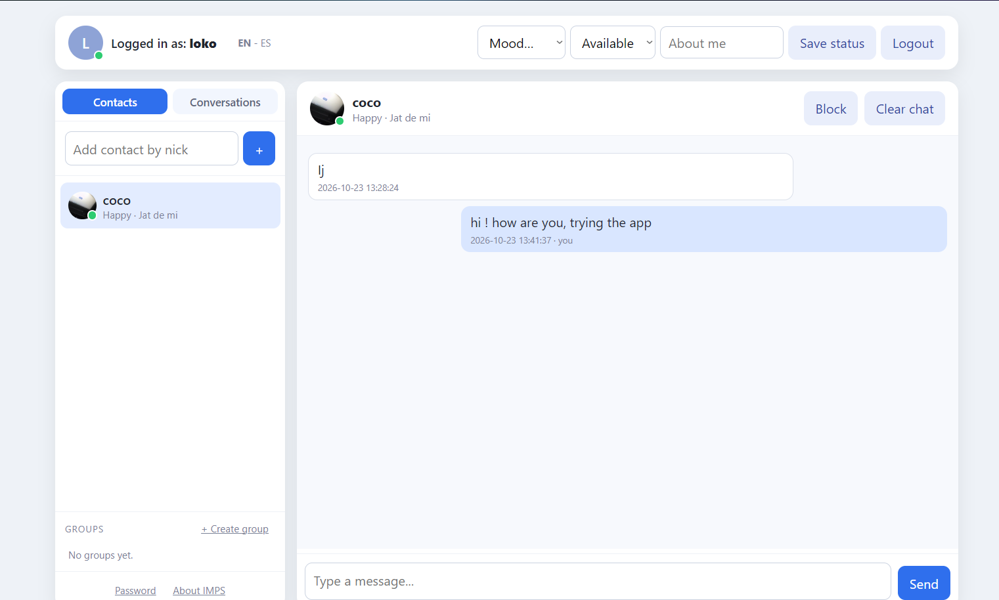

  

**Village IMPS / Wireless Village Server**  
Village is a small PHP + SQLite server for IMPS / Wireless Village clients.  
It was tested with the Sony Ericsson W200i app. Other clients used  
   
 different names for the same service, for example Nokia “My Presence”, Sony  
   
 Ericsson “My Friends” (or “Messenger”), and BlackBerry “IM”.  
It provides:  
- IMPS/CSP login with challenge/response.  
- Presence, contacts, groups and messaging.  
- A web interface for registration, chat, groups and password management.  
- Real login authentication for the mobile client.  
The mobile client does **not** need any changes. It continues to send its normal  
   
 `Login-Request` / nonce / `DigestBytes` flow. The server now verifies the digest  
   
 against the user's password.  
**Mobile password**  
The mobile password is the same as the web password.  
- Register on the web with your normal password.  
- The same password is stored, encrypted, for the mobile client.  
- On the W200i, enter:  
  - Nick: your registered nick  
  - Password: the same password  
  - Server URL: `http://your-domain/imps.php`  
**Requirements**  
- PHP 8.x  
- PDO extension enabled  
- PDO SQLite / SQLite3 extension enabled  
- OpenSSL extension enabled  
- Apache/LiteSpeed with `.htaccess` support  
- Writable directory for `wv.sqlite` and `imps.key`  
Important: the mobile client uses plain HTTP. Do **not** force HTTPS for  
   
 `imps.php`.  
**Database**  
The schema is in `schema.sql`. The application creates/updates the required  
   
 tables and columns automatically through `db.php`.  
No manual SQL migration is required for a new installation.  
**PHP extensions**  
Make sure these PHP extensions are enabled in the hosting panel:  
- `pdo`  
- `pdo_sqlite`  
- `sqlite3`  
- `openssl`  
If registration or login fails with `Class "PDO" not found`, PDO/SQLite is not  
   
 enabled.  
**Troubleshooting**  
Check `csp.log` on the server.  
Useful log lines:  
   
LOGIN OK nick=...  
 LOGIN FAIL nick=... ip=... digest_len=24 nonce=yes  
 LOGIN FAIL nick=... ip=... digest_len=24 nonce=no  
   
   
Meaning:  
- `LOGIN OK`: login succeeded.  
- `nonce=yes` but failed: the digest did not match; check the mobile password.  
- `nonce=no`: the challenge expired or was not stored.  
Also check the web server `error_log` for PHP errors such as missing PDO/SQLite  
   
 extensions.  
**Screenshot**  

  
